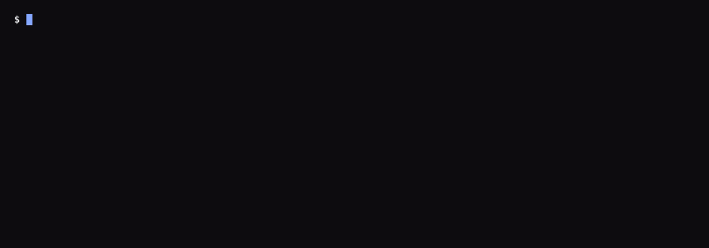
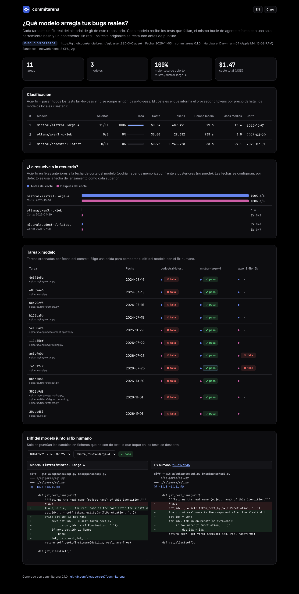
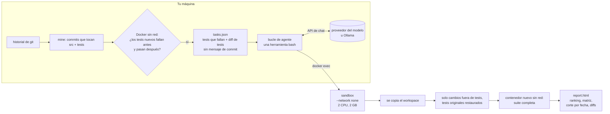

<p align="center"></p>

<p align="center">
<a href="https://github.com/diegoperezg7/commitarena/actions/workflows/ci.yml"></a>
<a href="LICENSE"></a>
<a href="https://github.com/diegoperezg7/commitarena/releases"></a>
<a href="https://github.com/diegoperezg7/commitarena/stargazers"></a>
</p>

<p align="center"><b>Tu historial de git es el benchmark. Reproduce fixes reales contra cualquier modelo, en un sandbox sin red.</b></p>

<p align="center"><a href="README.md">English</a> · <a href="https://diegoperezg7.github.io/commitarena/">Informe de ejemplo</a></p>

<p align="center"></p>

commitarena busca en tu repositorio los commits en los que un fix vino con un test, comprueba en Docker
que el test falla sin el fix y pasa con él, y le pide a cada modelo que haga pasar ese test. Todos los
modelos usan el mismo bucle de agente pequeño con una sola herramienta `bash`, y cada comando que ejecutan
corre en un contenedor arrancado con `--network none`. El informe separa el acierto en fixes anteriores y
posteriores a la fecha de corte de entrenamiento de cada modelo, para ver si el modelo resuelve el bug o
recuerda el parche.

## Por qué

Hay herramientas buenas cerca de esto. Lo que yo quería y no encontré junto:

| | Qué hace | Diferencia |
|---|---|---|
| [sjarmak/codeprobe](https://github.com/sjarmak/codeprobe) (10 estrellas) | Mina PRs fusionadas, corre CLIs de agentes y saca ranking con coste e informe HTML. | Su README dice que cada agente corre "inside a `--network=bridge` container (the agent needs the model API)". En commitarena el modelo se llama desde el host y el código que escribe el modelo nunca tiene red. |
| [PozziTiv4ik/Repo-Trials](https://github.com/PozziTiv4ik/Repo-Trials) (0 estrellas) | Tareas FAIL_TO_PASS a partir de tu historial de git. | commitarena añade el mismo arnés para todos los modelos, también los locales, y el corte antes/después de la fecha de entrenamiento. |
| [harbor-framework/harbor](https://github.com/harbor-framework/harbor) (6.755 estrellas) | Un framework general de evaluación de agentes. | commitarena es un comando para una pregunta: qué modelo arregla los bugs de este repo. |

Estrellas sacadas de la API de GitHub el 3 nov 2026.

Tres cosas que commitarena hace a propósito:

1. **Sin red para el código del modelo.** El bucle del agente corre en tu máquina y solo envía peticiones
   de chat. Cada llamada a `bash` va por `docker exec` a un contenedor con `--network none`,
   `--cap-drop ALL`, `no-new-privileges`, 2 CPU, 2 GB, límite de procesos y timeout por comando.
2. **Un arnés para todos.** Mismo prompt de sistema, misma herramienta, mismos límites de pasos y tiempo,
   sea un modelo en la nube o uno de 4B en Ollama. Sin agentes del fabricante ni herramientas extra.
3. **¿Lo resuelve o lo recuerda?** Los repos públicos están en los datos de entrenamiento. El informe
   pone el acierto en fixes anteriores a la fecha de corte de cada modelo junto al de los posteriores. Las
   fechas se configuran; por defecto se usa la fecha de lanzamiento del modelo, que es una cota segura.

## Inicio rápido

La demo no necesita claves ni Docker. Muestra una ejecución grabada y escribe el informe HTML.

```bash
uvx --from git+https://github.com/diegoperezg7/commitarena@v0.1.1 commitarena demo
```

O desde un clon:

```bash
git clone https://github.com/diegoperezg7/commitarena && cd commitarena && uv run commitarena demo
```

`uvx commitarena` llegará pronto a PyPI.

## Ejemplo de salida

<!-- demo:start -->
```text
$ commitarena demo
Recorded result (not a live run): 2026-11-03, commitarena 0.1.0, models mistral/codestral-latest,
mistral/ministral-8b-latest, mistral/mistral-large-4, on Darwin arm64 (Apple M4, 16 GB RAM).
Repo: https://github.com/andialbrecht/sqlparse (BSD-3-Clause)
Leaderboard
┏━━━━━━━━━━━━━━━━━━━━━━━━━━━━━┳━━━━━━━┳━━━━━━┳━━━━━━━━━━━━━━━┳━━━━━━━━━━━━━━┳━━━━━━━━┳━━━━━━━━━━━┳━━━━━━━┳━━━━━━━━━━━┓
┃ model                       ┃  pass ┃ rate ┃ before cutoff ┃ after cutoff ┃ cost $ ┃    tokens ┃ avg s ┃ avg steps ┃
┡━━━━━━━━━━━━━━━━━━━━━━━━━━━━━╇━━━━━━━╇━━━━━━╇━━━━━━━━━━━━━━━╇━━━━━━━━━━━━━━╇━━━━━━━━╇━━━━━━━━━━━╇━━━━━━━╇━━━━━━━━━━━┩
│ mistral/mistral-large-4     │ 11/11 │ 100% │           8/8 │          3/3 │ 0.5401 │   672,848 │   118 │      11.1 │
│ mistral/ministral-8b-latest │  1/11 │   9% │           0/5 │          1/6 │ 0.2445 │ 1,630,017 │    68 │      28.3 │
│ mistral/codestral-latest    │  0/11 │   0% │           0/4 │          0/7 │ 0.6507 │ 2,038,536 │    75 │      27.8 │
└─────────────────────────────┴───────┴──────┴───────────────┴──────────────┴────────┴───────────┴───────┴───────────┘
```
<!-- demo:end -->

<p align="center"><a href="https://diegoperezg7.github.io/commitarena/"></a></p>

Cómo leerlo: con el mismo prompt, herramienta, límites y sandbox, Mistral Large 4 arregló los 11 bugs,
incluidos los 3 posteriores a su lanzamiento (octubre de 2026), así que los resolvió, no los recordó.
Ministral 8B arregló uno, y ese es posterior a su propio corte. Codestral no arregló ninguno. Tres tareas
después del corte es una muestra pequeña: es una señal, no un veredicto.

**Por qué Codestral saca 0/11.** Es el modelo, no la puntuación: repitió literalmente un comando anterior
en 170 de sus 304 llamadas, siguió haciéndolo tras 163 avisos del arnés ("you already ran this exact
command"), agotó sus 30 pasos en 9 de 11 intentos, no cambió el código en 6 y no tocó ningún test. Así
empieza la tarea de `PRIMARY KEY`, cuyo fix humano es una línea de regex en `sqlparse/keywords.py`
(trayectorias completas en [docs/demo-run/trajectories](docs/demo-run/trajectories)):

```text
12 grep -n 'PRIMARY' sqlparse/keywords.py
13 sed -n '440,450p' sqlparse/keywords.py
14 sed -n '440,450p' sqlparse/keywords.py      <- aviso de repetición
15 grep -n 'KEY' sqlparse/keywords.py
...
23 grep -n 'PRIMARY' sqlparse/keywords.py      <- aviso de repetición
24 sed -n '440,450p' sqlparse/keywords.py      <- aviso de repetición
25 grep -n 'KEY' sqlparse/keywords.py          <- aviso de repetición
```

## Úsalo en tu repo

Necesitas Docker en marcha y Ollama o una API key.

```bash
# 1. Minar tareas: commits que cambian código y tests, validados en Docker
commitarena mine https://github.com/tu/turepo --max-tasks 10

# 2. Ejecutar modelos (uno local y uno en la nube)
export MISTRAL_API_KEY=...
commitarena run --tasks tasks/tu-turepo/tasks.json \
  --models ollama/qwen3:4b-16k,mistral/codestral-latest --max-cost 1

# 3. El informe queda en runs/<fecha>/report.html; se puede regenerar con otras fechas de corte
commitarena report runs/<fecha> --cutoff mistral/codestral-latest=2025-07-31 --open
```

## Cómo funciona



- **Minado.** Commits sin merge que cambian al menos un fichero de test y al menos un `.py` de código
  (por defecto solo fixes pequeños). Para cada uno la suite corre dos veces en un contenedor sin red: el
  commit padre con los tests nuevos, y el commit del fix. La tarea se queda si algún test pasa de fallar a
  pasar (FAIL_TO_PASS) y no se rompe nada de lo que pasaba (PASS_TO_PASS). La imagen de tests se construye
  una vez por repo con tu comando de instalación, que es el único paso con red.
- **El prompt** lista los tests que fallan, el diff de los tests y la salida del fallo. Nunca se enseña
  el mensaje del commit, la issue ni el fix humano. El workspace lleva un historial de git nuevo de un solo
  commit, para que el historial real no filtre el fix.
- **Puntuación.** Al acabar se copia el workspace. Solo se aplican los cambios en ficheros que no son de
  test sobre una copia limpia, así que lo que toque en tests o `conftest.py` se descarta, y la suite
  completa corre en un contenedor nuevo. Acierto = pasan todos los FAIL_TO_PASS y no falla ningún
  PASS_TO_PASS.
- **Métricas.** Acierto, coste (el que informa OpenRouter, si no tokens por precio de lista; los modelos
  locales cuestan 0), tokens de entrada y salida, tiempo y pasos (llamadas al modelo).

## Configuración

| Opción | Por defecto | |
|---|---|---|
| `run --models` | | `proveedor/modelo` separados por comas. Proveedores: `openrouter`, `openai`, `mistral`, `ollama`. |
| `run --max-cost` | `1.0` | USD. Se comprueba antes de cada llamada; la ejecución para con resultados parciales. |
| `run --max-steps` / `--max-time` | `30` / `1200` | Llamadas al modelo y segundos por intento. |
| `run --cutoff MODELO=FECHA` | fecha de lanzamiento | Fecha de corte para el reparto antes/después (repetible). |
| `run --price MODELO=IN,OUT` | integrado | USD por millón de tokens para modelos sin precio conocido. |
| `run --context-file F` | | Inyecta un AGENTS.md / CLAUDE.md: `--context-mode both\|repo\|prompt`. |
| `run --strip-context-files` | no | Quita el AGENTS.md / CLAUDE.md propio del repo antes del intento. |
| `run --cpus` / `--memory` / `--command-timeout` | `2` / `2g` / `120` | Límites del sandbox. |
| `mine --since` / `--until` / `--scan` / `--max-tasks` | | Qué commits se miran. |
| `mine --python` / `--setup` | `3.12` / `pip install -e .` | Cómo se construye la imagen de tests. |

Variables de entorno: `OPENROUTER_API_KEY`, `OPENAI_API_KEY`, `MISTRAL_API_KEY`, `OLLAMA_HOST`,
`COMMITARENA_CACHE` (clones, por defecto `~/.cache/commitarena`). Ver [.env.example](.env.example). No hay
telemetría.

**Ventana de contexto en Ollama.** El endpoint compatible con OpenAI de Ollama ignora `num_ctx`, y la
ventana por defecto puede ser de 4096 tokens, lo que tira el texto de la tarea sin avisar y da peores
resultados. commitarena avisa. Usa una variante con `num_ctx 16384` (la usada en el desarrollo es
`qwen3:4b-16k`); el bucle del agente elide las salidas más antiguas para caber en 16K.

```bash
printf 'FROM qwen3:4b\nPARAMETER num_ctx 16384\n' > Modelfile && ollama create qwen3:4b-16k -f Modelfile
commitarena run --tasks tasks.json --models ollama/qwen3:4b-16k
```

Los modelos locales pasan exactamente por el mismo código (qwen3:4b-16k se ejecutó durante el desarrollo),
pero no está en la demo grabada. En esta máquina gastaba los 4096 tokens de cada respuesta
razonando y nunca llamaba a la herramienta, y no hubo forma de desactivar el razonamiento por el endpoint
de OpenAI (se probaron `think: false`, `reasoning_effort: "none"` y `/no_think`). Subir el límite solo para
un modelo rompería la regla de arnés único, así que se dejó fuera en vez de mostrar un 0 engañoso.

## API de Python

```python
from commitarena import load_tasks, run_task, Budget, ContextFile

task = load_tasks("tasks.json")[0]
res = run_task(task, "ollama/qwen3:4b-16k", budget=Budget(max_cost=1.0),
               context=ContextFile(open("AGENTS.md").read(), in_repo=True, in_prompt=True))
print(res.passed, res.cost_usd, res.tokens_in, res.steps, res.wall_time_s)
```

## Datos de la demo

La demo grabada usa 11 tareas minadas de [sqlparse](https://github.com/andialbrecht/sqlparse)
(BSD-3-Clause, Copyright (c) 2016, Andi Albrecht). Los ficheros incluidos contienen los tests que fallan,
los diffs de los tests y los fixes originales como diffs, cada uno enlazado a su commit. La licencia original va incluida literal en
[src/commitarena/demo/LICENSE-sqlparse](src/commitarena/demo/LICENSE-sqlparse).

## Hoja de ruta

- Otros lenguajes y runners de tests
- Claude Code y Codex como concursantes
- Texto de la issue de GitHub como prompt opcional
- pass@k e intentos repetidos
- Ejecución en paralelo
- Exportar a Harbor

## Parte de una serie

Herramientas open source para medir agentes y LLMs con tus propios datos:

- [memarena](https://github.com/diegoperezg7/memarena): Compara capas de memoria con tus propias conversaciones.
- [parsearena](https://github.com/diegoperezg7/parsearena): Compara parsers de PDF lado a lado y su efecto en la recuperación.
- [toolbloat](https://github.com/diegoperezg7/toolbloat): Mide el coste en tokens de tu pila MCP y los errores al elegir tool.
- [rulelab](https://github.com/diegoperezg7/rulelab): Descubre qué reglas de tu AGENTS.md se ganan sus tokens.
- [doesitfire](https://github.com/diegoperezg7/doesitfire): Comprueba si tu SKILL.md se activa en Claude Code, Codex y OpenCode.

## Licencia

MIT. Ver [LICENSE](LICENSE).
