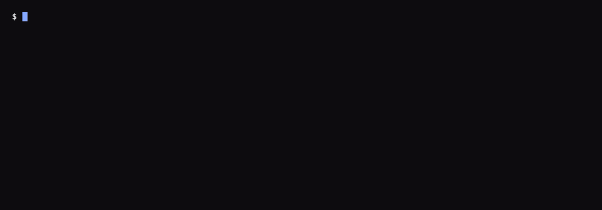
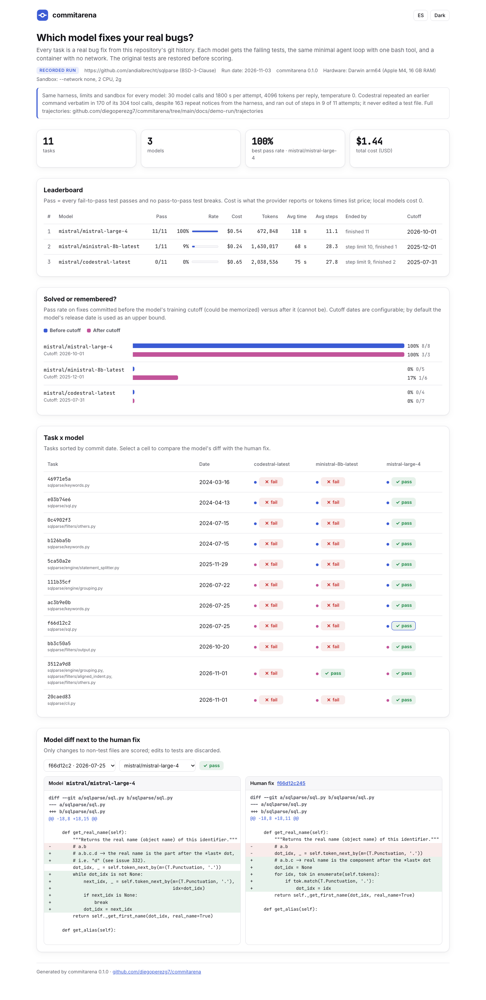
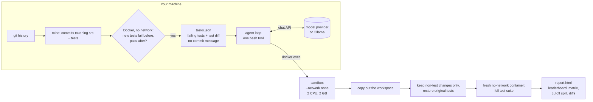

<p align="center"></p>

<p align="center">
<a href="https://github.com/diegoperezg7/commitarena/actions/workflows/ci.yml"></a>
<a href="LICENSE"></a>
<a href="https://github.com/diegoperezg7/commitarena/releases"></a>
<a href="https://github.com/diegoperezg7/commitarena/stargazers"></a>
</p>

<p align="center"><b>Your git history is the benchmark. Replay real bug fixes against any model, in a sandbox with no network.</b></p>

<p align="center"><a href="README.es.md">Español</a> · <a href="https://diegoperezg7.github.io/commitarena/">Example report</a></p>

<p align="center"></p>

commitarena mines commits from your repository where a bug fix came with a test, checks in Docker that the
test fails without the fix and passes with it, and then asks each model to make that test pass. Every
model gets the same small agent loop with one `bash` tool, and every command it runs executes in a
container started with `--network none`. The report splits the pass rate into fixes committed before and
after each model's training cutoff, so you can see whether a model solves the bug or remembers the patch.

## Why

There are good tools close to this. What I wanted and did not find in one place:

| | What it does | Difference |
|---|---|---|
| [sjarmak/codeprobe](https://github.com/sjarmak/codeprobe) (10 stars) | Mines merged PRs, runs agent CLIs, ranks with cost and an HTML report. | Its README says each agent runs "inside a `--network=bridge` container (the agent needs the model API)". In commitarena the model is called from the host and the code the model writes never has a network. |
| [PozziTiv4ik/Repo-Trials](https://github.com/PozziTiv4ik/Repo-Trials) (0 stars) | FAIL_TO_PASS tasks from your git history. | commitarena adds the same harness for every model, local ones included, and the before/after-cutoff split. |
| [harbor-framework/harbor](https://github.com/harbor-framework/harbor) (6,755 stars) | A general framework for agent evaluations. | commitarena is one command for one question: which model fixes the bugs of this repo. |

Star counts from the GitHub API on 2026-11-03.

Three things commitarena does on purpose:

1. **No network for model-written code.** The agent loop runs on your machine and only sends chat
   requests. Each `bash` call goes through `docker exec` into a container with `--network none`,
   `--cap-drop ALL`, `no-new-privileges`, 2 CPU, 2 GB, a PID limit and a per-command timeout.
2. **One harness for every model.** Same system prompt, same single tool, same step and time limits,
   whether it is a hosted model or a 4B model on Ollama. No vendor agent, no extra tools.
3. **Solve or remember.** Public repos are in training data. The report shows pass rate on fixes dated
   before each model's cutoff next to fixes dated after it. Cutoffs are configurable; by default the
   model's release date is used, which is a safe upper bound.

## Quickstart

The demo needs no API keys and no Docker. It prints a recorded run and writes the HTML report.

```bash
uvx --from git+https://github.com/diegoperezg7/commitarena@v0.1.0 commitarena demo
```

Or from a clone:

```bash
git clone https://github.com/diegoperezg7/commitarena && cd commitarena && uv run commitarena demo
```

`uvx commitarena` is coming to PyPI.

## Example output

<!-- demo:start -->
```text
$ commitarena demo
Recorded result (not a live run): 2026-11-03, commitarena 0.1.0, models mistral/codestral-latest,
mistral/ministral-8b-latest, mistral/mistral-large-4, on Darwin arm64 (Apple M4, 16 GB RAM).
Repo: https://github.com/andialbrecht/sqlparse (BSD-3-Clause)
Leaderboard
┏━━━━━━━━━━━━━━━━━━━━━━━━━━━━━┳━━━━━━━┳━━━━━━┳━━━━━━━━━━━━━━━┳━━━━━━━━━━━━━━┳━━━━━━━━┳━━━━━━━━━━━┳━━━━━━━┳━━━━━━━━━━━┓
┃ model                       ┃  pass ┃ rate ┃ before cutoff ┃ after cutoff ┃ cost $ ┃    tokens ┃ avg s ┃ avg steps ┃
┡━━━━━━━━━━━━━━━━━━━━━━━━━━━━━╇━━━━━━━╇━━━━━━╇━━━━━━━━━━━━━━━╇━━━━━━━━━━━━━━╇━━━━━━━━╇━━━━━━━━━━━╇━━━━━━━╇━━━━━━━━━━━┩
│ mistral/mistral-large-4     │ 11/11 │ 100% │           8/8 │          3/3 │ 0.5401 │   672,848 │   118 │      11.1 │
│ mistral/ministral-8b-latest │  1/11 │   9% │           0/5 │          1/6 │ 0.2445 │ 1,630,017 │    68 │      28.3 │
│ mistral/codestral-latest    │  0/11 │   0% │           0/4 │          0/7 │ 0.6507 │ 2,038,536 │    75 │      27.8 │
└─────────────────────────────┴───────┴──────┴───────────────┴──────────────┴────────┴───────────┴───────┴───────────┘
```
<!-- demo:end -->

<p align="center"><a href="https://diegoperezg7.github.io/commitarena/"></a></p>

How to read it: with the same prompt, tool, limits and sandbox, Mistral Large 4 fixed all 11 bugs,
including the 3 committed after its release (October 2026), so it was solving, not recalling. Ministral 8B
fixed one, and that one is dated after its own cutoff. Codestral fixed none. Three tasks after a cutoff is
a small sample: treat the split as a signal, not a verdict.

**Why Codestral scores 0/11.** It is the model, not the scoring: it repeated an earlier command verbatim
in 170 of its 304 tool calls, kept doing so after 163 "you already ran this exact command" notices from
the harness, ran out of its 30 steps in 9 of 11 attempts, left the code untouched in 6, and never edited a
test file. This is the start of the `PRIMARY KEY` task, whose human fix is one regex line in
`sqlparse/keywords.py` (full trajectories are in [docs/demo-run/trajectories](docs/demo-run/trajectories)):

```text
12 grep -n 'PRIMARY' sqlparse/keywords.py
13 sed -n '440,450p' sqlparse/keywords.py
14 sed -n '440,450p' sqlparse/keywords.py      <- repeat notice
15 grep -n 'KEY' sqlparse/keywords.py
...
23 grep -n 'PRIMARY' sqlparse/keywords.py      <- repeat notice
24 sed -n '440,450p' sqlparse/keywords.py      <- repeat notice
25 grep -n 'KEY' sqlparse/keywords.py          <- repeat notice
```

## Use it on your repo

You need Docker running, plus Ollama or an API key.

```bash
# 1. Mine tasks: commits that change source and tests, validated in Docker
commitarena mine https://github.com/you/yourrepo --max-tasks 10

# 2. Run models (a local one and a hosted one)
export MISTRAL_API_KEY=...
commitarena run --tasks tasks/you-yourrepo/tasks.json \
  --models ollama/qwen3:4b-16k,mistral/codestral-latest --max-cost 1

# 3. The report is written to runs/<timestamp>/report.html; re-render it with other cutoffs
commitarena report runs/<timestamp> --cutoff mistral/codestral-latest=2025-07-31 --open
```

## How it works



- **Mining.** Non-merge commits that change at least one test file and at least one `.py` source file
  (small fixes only by default). For each one the test suite runs twice in a no-network container: the
  parent commit plus the new test files, and the fix commit. A task is kept when some tests go from
  failing to passing (FAIL_TO_PASS) and nothing that passed before breaks (PASS_TO_PASS). The test image
  is built once per repo with your install command, which is the only step with network.
- **The prompt** lists the failing tests, the test diff and the current failure output. The commit
  message, the issue and the human fix are never shown. The workspace gets a fresh one-commit git history
  so the real history cannot leak the fix.
- **Scoring.** After the attempt the workspace is copied out. Only changes to non-test files are applied
  onto a pristine copy, so edits to tests or `conftest.py` are discarded, and the full suite runs in a
  fresh container. Pass means every FAIL_TO_PASS test passes and no PASS_TO_PASS test fails.
- **Metrics.** Pass, cost (provider-reported for OpenRouter, otherwise tokens times list price; local
  models cost 0), input and output tokens, wall time and steps (model calls).

## Configuration

| Flag | Default | |
|---|---|---|
| `run --models` | | Comma-separated `provider/model`. Providers: `openrouter`, `openai`, `mistral`, `ollama`. |
| `run --max-cost` | `1.0` | USD. Checked before every model call; the run stops with partial results. |
| `run --max-steps` / `--max-time` | `30` / `1200` | Model calls and seconds per attempt. |
| `run --cutoff MODEL=DATE` | release date | Training cutoff used for the before/after split (repeatable). |
| `run --price MODEL=IN,OUT` | built-in | USD per million tokens for models without a known price. |
| `run --context-file F` | | Inject an AGENTS.md / CLAUDE.md: `--context-mode both\|repo\|prompt`. |
| `run --strip-context-files` | off | Remove the repo's own AGENTS.md / CLAUDE.md before the attempt. |
| `run --think` / `--no-think` | model default | Ollama only: turn reasoning on or off for models like qwen3. |
| `run --cpus` / `--memory` / `--command-timeout` | `2` / `2g` / `120` | Sandbox limits. |
| `mine --since` / `--until` / `--scan` / `--max-tasks` | | Which commits to consider. |
| `mine --python` / `--setup` | `3.12` / `pip install -e .` | How the test image is built. |

Environment variables: `OPENROUTER_API_KEY`, `OPENAI_API_KEY`, `MISTRAL_API_KEY`, `OLLAMA_HOST`,
`COMMITARENA_CACHE` (clones, default `~/.cache/commitarena`). See [.env.example](.env.example). There is
no telemetry.

**Ollama context window.** Ollama's OpenAI-compatible endpoint ignores `num_ctx`, and its default
window can be 4096 tokens, which silently drops the task text and gives worse results. commitarena warns
about it. Use a variant with `num_ctx 16384` (this is the one used in development, `qwen3:4b-16k`); the
agent loop elides older tool outputs to stay inside 16K. For reasoning models, `--no-think` asks Ollama to
skip thinking: with thinking on, qwen3:4b spent its whole 4096-token reply on reasoning and never called
the tool in our tests.

```bash
printf 'FROM qwen3:4b\nPARAMETER num_ctx 16384\n' > Modelfile && ollama create qwen3:4b-16k -f Modelfile
commitarena run --tasks tasks.json --models ollama/qwen3:4b-16k --no-think
```

## Python API

```python
from commitarena import load_tasks, run_task, Budget, ContextFile

task = load_tasks("tasks.json")[0]
res = run_task(task, "ollama/qwen3:4b-16k", budget=Budget(max_cost=1.0),
               context=ContextFile(open("AGENTS.md").read(), in_repo=True, in_prompt=True))
print(res.passed, res.cost_usd, res.tokens_in, res.steps, res.wall_time_s)
```

## Demo data

The recorded demo uses 11 tasks mined from [sqlparse](https://github.com/andialbrecht/sqlparse)
(BSD-3-Clause, Copyright (c) 2016, Andi Albrecht). The bundled files contain the failing tests, the test
diffs and the upstream fixes as diffs, each linked to its commit.

## Roadmap

- Other languages and test runners
- Claude Code and Codex as contestants
- GitHub issue text as an optional prompt
- pass@k and repeated attempts
- Parallel runs
- Export to Harbor

## License

MIT. See [LICENSE](LICENSE).
